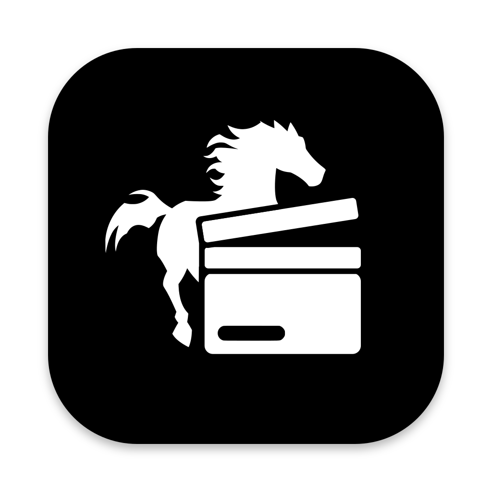
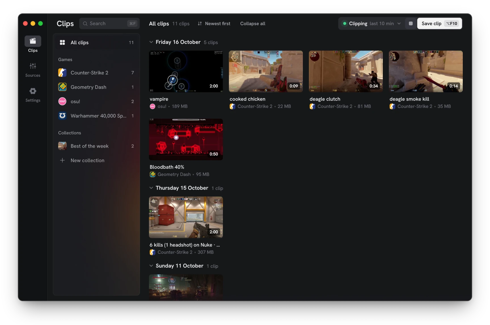
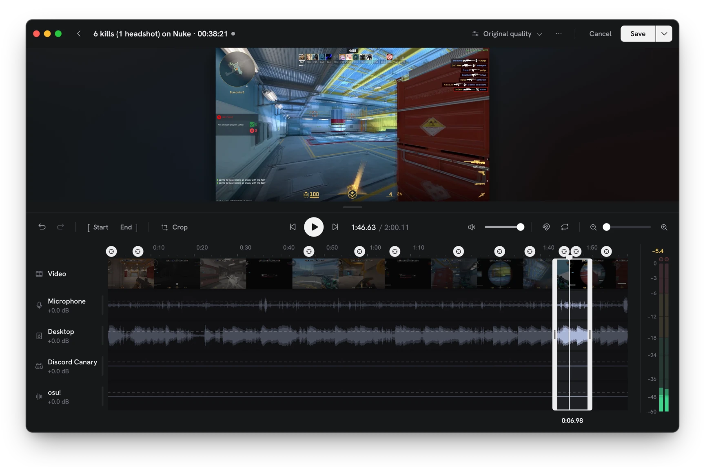
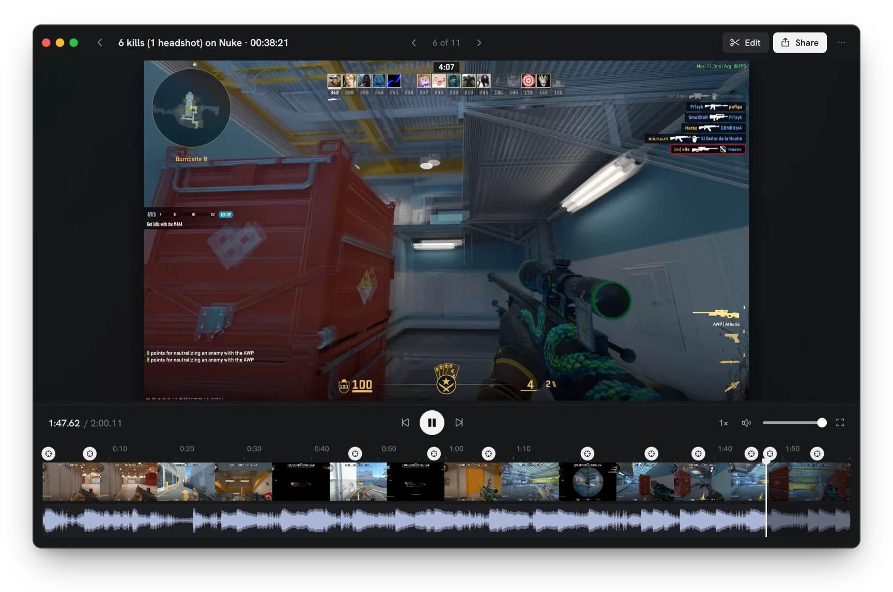

<p align="center">
  
</p>

<h1 align="center">HasteClip <sup>beta</sup></h1>

<p align="center">
  A fast, no-nonsense clip recorder and editor for macOS, Windows and Linux.<br>
  It keeps the last few minutes of your game ready. Press a key when something happens, trim it, share it.<br>
  Free and open source. No ads, no account, no watermark.
</p>

<p align="center">
  <a href="https://github.com/hasteclip/hasteclip/releases/latest"><b>Download</b></a> ·
  <a href="https://hasteclip.com">Website</a> ·
  <a href="#features">Features</a> ·
  <a href="#building-from-source">Build from source</a>
</p>

<p align="center">
  
</p>

## Contents

- [Download](#download)
- [Getting started](#getting-started)
- [Features](#features)
- [Compared with other recorders](#compared-with-other-recorders)
- [Platform support](#platform-support)
- [Building from source](#building-from-source)
- [License](#license)

## Download

Download yours from the [latest release](https://github.com/hasteclip/hasteclip/releases/latest). Every package includes ffmpeg.

| System | File | Requirements | Updates |
|---|---|---|---|
| macOS | `HasteClip-mac-arm64.dmg` | macOS 13 or later, Apple Silicon | By hand, for now |
| Windows | `HasteClip-win-Setup.exe` | Windows 10 (2004) or 11 | Automatic |
| Linux | `HasteClip-linux-x64.tar.gz` | x86-64, Wayland or X11, PipeWire | Automatic |

Automatic updates download in the background and install when you quit, never mid-game. You can turn them off in *Settings → App*.

<details>
<summary><b>macOS</b></summary>

Open the `.dmg` and drag HasteClip to Applications.

The app isn't signed by Apple yet, so macOS blocks the first launch. Open it once, then go to *System Settings → Privacy & Security* and click *Open Anyway*. You can also run `xattr -dr com.apple.quarantine /Applications/HasteClip.app` instead.

On first launch, macOS asks for **Screen & System Audio Recording** permission, and for **Microphone** permission if you record your mic. Grant them, then restart HasteClip. After an update, macOS may ask for Screen Recording permission again.
</details>

<details>
<summary><b>Windows</b></summary>

Run `HasteClip-win-Setup.exe`. It installs for your user only, so there's no admin prompt.

Windows asks for nothing, except microphone access if *Settings → Privacy & security → Microphone* is off for desktop apps. Some GPU overlays use the same shortcut: NVIDIA's Instant Replay, for example, uses <kbd>Alt</kbd> + <kbd>F10</kbd>. HasteClip's settings tell you if a shortcut couldn't be registered.
</details>

<details>
<summary><b>Linux</b></summary>

Unpack the tarball into a folder that's yours to write to, so updates can replace it, and run `./hasteclip`. On first launch it adds itself to your apps (`~/.local/share/applications`).

The first time you record or open **Sources**, your desktop asks which screen to share. HasteClip remembers your choice, and *Sources → Choose another…* asks again. On Wayland, global shortcuts go through your desktop: it may ask once to allow them, and you change their keys in its keyboard settings.
</details>

## Getting started

1. **Open HasteClip.** Clipping starts right away. It keeps the last minute in memory, and nothing is written to your drive until you save.
2. **Play.** When something happens, press <kbd>Alt</kbd> + <kbd>F10</kbd> (<kbd>Option</kbd> + <kbd>F10</kbd> on macOS). You can also say **“HasteClip that”** if a microphone is set up.
3. **Find it in your library.** The clip lands under *Today*, in its game's folder. Click it to watch, then **Edit** to trim it or **Share** to send it.

Then make it yours:

- **Sources** is what goes into your clips: the screen or a game's window, your microphone, your desktop sound, single apps, and a webcam.
- **Settings** has the clip length (5 seconds to an hour), resolution, frame rate, quality, file format, the clips folder, and more shortcuts. Start or stop clipping, start or stop recording, and take a screenshot are off until you pick a key for them.

Clips are saved in a `hasteclip` folder in your Videos folder (Movies on macOS), with one folder per game. You can change this in *Settings → Clips*.

## Features

### Clip and record

- **Replay buffer.** It keeps the last 5 seconds to 1 hour in memory. Save it with a shortcut, or by voice: “HasteClip that” is recognised on your computer and never sent anywhere.
- **Clips named after the play.** “3 kills on Mirage”, “Pentakill as Jinx”, “412pp FC”: clips of Counter-Strike 2, Dota 2, League of Legends and osu! are named after what happened. Other games' clips are named by the time.
- **Recording.** Record straight to disk for as long as you like. A crash or power loss still leaves a playable file.
- **Native, hardware encoding.** H.264 on your graphics card's video engine, at native resolution or scaled down, up to 540 fps at 1080p. HasteClip is written in Rust and draws on the GPU, with no browser running behind your game.
- **Any shape.** Record the whole screen or a game's window, in its own aspect ratio or another, like 16:9 from an ultrawide screen.
- **Sound as sources, not tracks.** Add your microphone, desktop sound, or single apps like the game, Discord or music. For each one, choose whether it's in the clip's sound, has its own track for editing later, or both. Each source has a live meter and a fader. There's noise reduction and mono for microphones, and a limiter on the mix.
- **Webcam.** Show your camera in a corner, placed and cropped by dragging it on the preview.

### Edit

<p align="center">
  
</p>

- **Frame-accurate trimming.** Drag the ends, or press <kbd>I</kbd> and <kbd>O</kbd>.
- **Fast saving.** Only the frames around each cut are re-encoded, and the rest is copied as it is. A trim saves in seconds and looks exactly like the original.
- **Every track on its own lane.** Turn your mic down after the fact, and draw volume changes along the timeline.
- **Crop** to 16:9, 4:3, 1:1, 9:16 for phones, or any shape.
- **Export smaller copies** at a lower resolution or frame rate, or to fit a size, like under 25 MB.
- **Non-destructive.** Your original recording is kept, so you can revert at any time, or free up the space once you're happy.

### Watch, organize and share

<p align="center">
  
</p>

- **A library that sorts itself.** Clips are grouped by day and by game automatically. Collections hold the ones worth keeping. Search, sort, and rename (<kbd>F2</kbd>) or delete a clip with one key.
- **A player made for clips.** Step frame by frame, jump between moments such as kills and your own markers (<kbd>B</kbd>), and change the speed. Press <kbd>?</kbd> for every shortcut.
- **Share with a link.** Upload a clip for a link that plays in any browser and right in a Discord chat. No account is needed.
- **Or share the file.** Copy a clip and paste it anywhere, or drag one (or ten) out of the library into Discord, a chat or a folder. You can also use your system's share sheet.
- **Export and import.** Move clips to another computer with their edits, markers and collections in one `.hasteclip` file.

## Compared with other recorders

|  | HasteClip | Medal | NVIDIA ShadowPlay | Steam Game Recording | OBS Studio |
|---|:-:|:-:|:-:|:-:|:-:|
| **Price** | Free | Free, or $9.99/mo | Free | Free | Free |
| **Runs on** | macOS, Windows, Linux | Windows | Windows | macOS, Windows, Linux | macOS, Windows, Linux |
| **Graphics card** | Any | Any | NVIDIA only | Any | Any |
| **Account** | Not needed | Asks you to sign in | Not needed | Steam account | Not needed |
| **Ads** | None | Yes, Premium removes them | ? | ? | None |
| **Open source** | ✅ | — | — | — | ✅ |
| **How far back it saves** | Up to 1 hour | Up to 10 min | Up to 20 min | Unlimited | Up to 6 hours |
| **Save a clip by voice** | ✅ | ✅ | With G-Assist | — | — |
| **Clips named after what happened** | ✅ | ✅ | ? | — | — |
| **Saves clips by itself** | — | ✅ 16 games | ✅ Highlights | Marks moments only | — |
| **Highest frame rate** | 540 fps | 144 fps | 240 fps | 60 fps | 120 fps |
| **Frame blending (smooth motion)** | ✅ | — | — | — | — |
| **Each sound on its own track** | ✅ | ✅ | Mic only | — | ✅ |
| **Smaller files (HEVC or AV1)** | — | ✅ | ✅ | HEVC | ✅ |
| **HDR video** | — | — | ✅ | — | ✅ |
| **Share with a link** | ✅ Free, no account | Needs an account, links last 14 days | — | Links last 2 days | — |
| **Drag clips into Discord** | ✅ | Open the folder first | ? | Export first | — |
| **Shrink to a size, like 10 MB** | ✅ | — | — | ✅ | — |
| **Trim** | ✅ | ✅ | ? | ✅ | — |

✅ yes · — no · ? we couldn't confirm it either way. Last checked 20 October 2026, mostly from each product's own pages; where those don't say, from its official forums or feedback board. Notes:

- **NVIDIA ShadowPlay:** NVIDIA doesn't publish how far back it saves; 20 minutes is what users report. Its trimming is unclear: NVIDIA's support article implies an edit button, but users say the NVIDIA App dropped trimming.
- **Frame rates:** HasteClip's 540 fps was measured at 1080p on an RTX 4060 Ti. OBS goes higher with custom settings.
- **HasteClip** records in H.264 so clips play everywhere, and records HDR screens in SDR.

The [full comparison](https://hasteclip.com/compare) adds AMD Adrenalin and Xbox Game Bar, and has more rows, notes and sources. Product names are their owners' trademarks; HasteClip isn't affiliated with any of them. If something here is out of date, please [open an issue](https://github.com/hasteclip/hasteclip/issues).

## Platform support

HasteClip is in beta (versions 0.x). It works day to day, but not every feature is on every system yet. Version 1.0 is when it is.

| Feature | macOS | Windows | Linux |
|---|:-:|:-:|:-:|
| Replay buffer, recording, editor, library | ✅ | ✅ | ✅ |
| Share links, copy, export and import | ✅ | ✅ | ✅ |
| Voice saving, named clips, per-app sound, webcam | ✅ | ✅ | ✅ |
| Record a single game or app window | ✅ | ✅ | ✅ (KDE Plasma) |
| Drag clips out, system share sheet | ✅ | ✅ | — (use Copy clip) |
| Frame blending | ✅ | ✅ | — |
| Automatic updates | — | ✅ | ✅ |
| Screenshots | — | ✅ | ✅ |
| Game capture for fullscreen games | — | ✅ | — |

**Encoders:** VideoToolbox on macOS. NVENC, AMF or Quick Sync through Media Foundation on Windows. NVENC or VA-API through ffmpeg on Linux, with x264 when there's no GPU encoder.

**Frame blending** captures several times faster than the clip's frame rate and blends those pictures into each frame, for smooth motion.

**Game capture** handles fullscreen games that Windows' own capture records as a frozen picture, or without their cursor (such as fullscreen OpenGL games like osu!). It uses [OBS Studio](https://obsproject.com)'s game capture hook. It is never used on games with anti-cheat unless you add the game in *Settings → Video → Game capture*. Those games are found from their anti-cheat's files, [AreWeAntiCheatYet](https://areweanticheatyet.com)'s list and a few known games.

**Named clips** read what the game reports itself. Counter-Strike 2 and Dota 2 use Valve's Game State Integration; Dota 2 also needs `-gamestateintegration` in its launch options. League of Legends uses its Live Client Data API. osu! needs [tosu](https://github.com/tosuapp/tosu) or gosumemory running.

## Building from source

You need:

- [Rust](https://rustup.rs) (stable).
- [ffmpeg](https://ffmpeg.org) on your `PATH`, or next to the app. The editor, thumbnails and playback use it, and so does encoding on Linux. On macOS, run `brew install ffmpeg`; on Windows, `winget install Gyan.FFmpeg`. On Linux, your distribution's ffmpeg must encode and decode H.264. Debian, Ubuntu and Arch's packages do. Fedora's own `ffmpeg-free` doesn't, so use RPM Fusion's: `sudo dnf swap ffmpeg-free ffmpeg --allowerasing`.
- On Linux: a C compiler, clang, and the PipeWire, D-Bus and ALSA headers. On Fedora, run `sudo dnf install gcc clang-devel pipewire-devel dbus-devel alsa-lib-devel`. On Debian or Ubuntu, run `sudo apt install build-essential libclang-dev libpipewire-0.3-dev libdbus-1-dev libasound2-dev`. You also need an xdg-desktop-portal for your desktop (GNOME, KDE Plasma, wlroots, Hyprland).

Then build and run:

```sh
git clone https://github.com/hasteclip/hasteclip.git
cd hasteclip
cargo run --release
```

On macOS, a build run from a terminal asks for permissions on the terminal app's behalf. On Windows, `pwsh scripts/fetch-game-hook.ps1` puts OBS Studio's game capture hook in `target/game-hook`, where a development build finds it. These are signed GPLv2 files that run as separate programs. Without them, games are recorded with Windows' own capture only.

### Project structure

| Crate | Purpose |
|---|---|
| `crates/app` | The desktop app (egui): library, player, editor, sources, settings |
| `crates/capture` | Screen and audio capture, mixing, encoding and writing files |
| `crates/media` | Probing, preview decoding and rendering edits |

### Releasing

Releases are cut by hand: run *Actions → Release → Run workflow* on `main`. [semantic-release](https://semantic-release.gitbook.io) picks the version from the [Conventional Commits](https://www.conventionalcommits.org) since the last tag:

- `fix:` makes a patch release.
- `feat:` makes a minor release.
- `feat!:`, or a `BREAKING CHANGE:` footer, makes a major release.
- `chore:`, `docs:`, `refactor:`, `ci:` and the like don't make a release on their own.

The release scripts build the app and bundle ffmpeg:

- `scripts/release.ps1` (Windows) also bundles OBS Studio's game capture hook. It packs everything with [Velopack](https://velopack.io) into the installer and the delta update packages.
- `scripts/release-mac.sh` builds the `.dmg`.
- `scripts/release-linux.sh` builds the tarball.

## License

HasteClip is free software. You can use, change and share it under the [GNU General Public License, version 3 or later](LICENSE). Copies and changed versions must stay under the same license, with their source available and this project's copyright notices kept.

The name "HasteClip" and its icon aren't covered by that license; see [TRADEMARKS.md](TRADEMARKS.md).

The releases bundle [ffmpeg](https://ffmpeg.org) (GPL), the [Hanken Grotesk](https://fonts.google.com/specimen/Hanken+Grotesk) font (SIL Open Font License), and, on Windows, [OBS Studio](https://obsproject.com)'s game capture hook (GPL-2.0-or-later).
